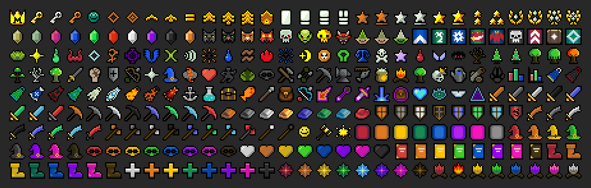

<h1 align="center">Loot Labels</h1>

  

Customizable and easy-to-change labels for items on the ground.

 

## Creating a group

To create a group, click the "+ GROUP" button in the top-right of the plugin sidebar. Name it whatever you like, then hit the "CREATE" button. This will create a blank group without items in it that you can now add items to and customize.

## Customizing a group

Choose from any of the 270 icons (from the in-game clan ranks icons) to represent a group, as well as any color you'd like for the label border/background to be made up of.

  

