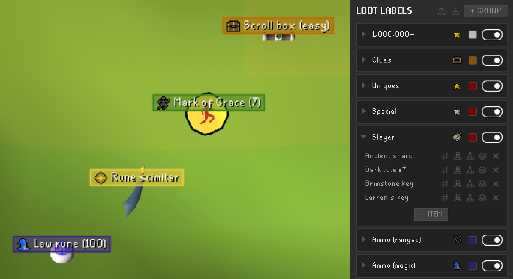
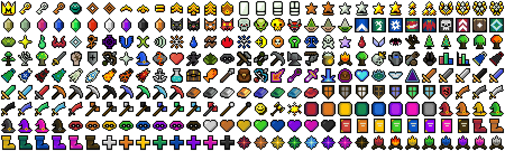
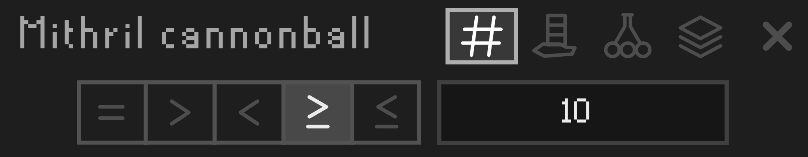

<h1 align="center">Loot Labels</h1>

  

Customizable and easy-to-change labels for items on the ground.

 

## Creating a group

To create a group, click the "+ GROUP" button in the top-right of the plugin sidebar. Name it whatever you like, then hit the "CREATE" button. This will create a blank group without items in it that you can now add items to and customize.

## Customizing a group

You can choose from any of 270 built-in icons to represent your group, making it show up next to item names in the labels. If you don't choose an icon, or click "NO ICON" in the icon dropdown, that group's items won't have an icon.

  

You can also choose any color for the group, which will make up the border and background fill of the labels. Clicking the color swatch will open up a color-picking popup for you to select your desired color.

## Adding items

You can add an item to a group by either 1) clicking the "+ ITEM" button in the group box and typing in the name (wildcards accepted via `*`), or 2) shift-right-clicking an item on the ground or your inventory and hovering over the "Add to Loot Labels" option, then selecting a group for it to go in.

## Filtering items

Once you've added an item into a group, you can make it so that labels only show up for that item if one or multiple conditions are met. By clicking the icons next to the item name, you can filter items by:

* Quantity
* GE value
* HA value
* Stackable-ness

  

## Plugin settings

You can also change various settings for the plugin, which will affect all groups. These settings include:

* **Display**, changing the appearance of the labels themselves
* **Font**, changing the appearance of the text within the labels
* **Values**, affecting whether GE, HA, both, or no values are shown in the labels
* **Despawn**, affecting whether despawn timers, either in pie or text form, are shown next to labels
* **Ownership**, affecting whether world spawns or others' drops show up for you
* **Menu**, altering the behavior of the right-click menu — including deprioritization, collapsing, and recoloring
* **Hotkey**, allow you to set a hotkey that, when clicked, shows various otherwise hidden values based on your settings
